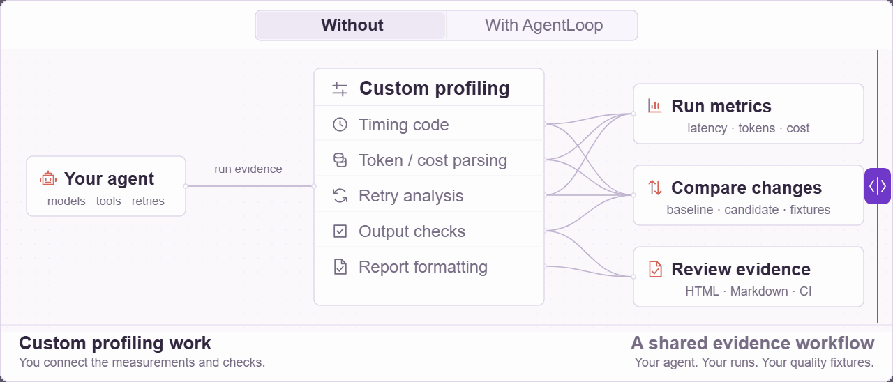
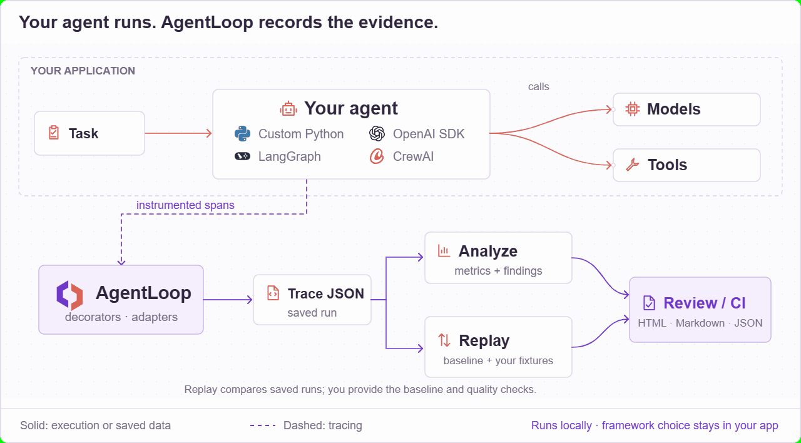

<h1 align="center">
  <picture>
    <source media="(prefers-color-scheme: dark)" srcset="docs/assets/agentloop-logo-dark.svg">
    
  </picture>
</h1>

<p align="center">
  <strong>Find wasted work in AI agents. Verify each change.</strong><br>
  Trace calls, inspect findings, and compare performance with your quality checks.
</p>

<p align="center">
  <a href="https://github.com/dipeshbabu/agentloop/actions/workflows/ci.yml"></a>
  <a href="https://pypi.org/project/agentloop-profiler/"></a>
  <a href="https://pepy.tech/projects/agentloop-profiler"></a>
  <a href="https://www.python.org/downloads/"></a>
  <a href="LICENSE"></a>
</p>

<p align="center">
  <a href="#quickstart">Quickstart</a> ·
  <a href="#record-your-own-run">Trace your code</a> ·
  <a href="#compare-before-and-after">Compare runs</a> ·
  <a href="#framework-integrations">Integrations</a> ·
  <a href="docs/FIRST_USE.md">Guide</a>
</p>

AgentLoop is a local profiler for AI agents and decision pipelines. It records
execution spans, reports latency and token usage, and identifies patterns such as
repeated calls, retry loops, and reused context. Compare saved runs to check whether
a change improves performance while still passing your output checks.

The core Python SDK and CLI work with JSON files. You can trace and analyze your
code without a hosted account or database. A dashboard, HTTP API, and shared
storage are available as optional components.

## Quickstart

Install with Python 3.10 or newer:

```bash
python -m pip install agentloop-profiler
agentloop quickstart
agentloop analyze runs/agentloop_quickstart.json --html runs/report.html --json-out runs/analysis.json
```

Open `runs/report.html` in your browser to inspect the timeline and findings.
`runs/analysis.json` contains the trace, metrics, diagnosis, and optimization plan.

The package name is `agentloop-profiler`; the Python import and CLI command are
both `agentloop`. `quickstart` creates a labeled synthetic trace and makes no model
API calls. It tests your installation, not your application's performance.

If your shell cannot find `agentloop`, activate the Python environment where you
installed it. Run `agentloop doctor` to check the installation and available adapters.

For an isolated install, create an environment with `python -m venv .venv`, then
activate it with `source .venv/bin/activate` on Linux/macOS or
`.\.venv\Scripts\Activate.ps1` in Windows PowerShell before installing the package.

## Record your own run

Save this as `example_agent.py`. It traces local functions and saves their output
for the quality check below. It runs without a model SDK or API key.

```python
import agentloop

NOTES = {
    "tracing": "Record the steps in a workflow.",
    "optimization": "Investigate repeated or expensive work.",
    "replay": "Compare saved baseline and candidate traces.",
}


@agentloop.trace_tool(name="lookup_note")
def lookup_note(topic: str) -> str:
    return NOTES[topic]


with agentloop.trace_agent("research_agent") as trace:
    output = {"notes": [lookup_note(topic) for topic in NOTES]}
    trace.metadata["output"] = output

trace.export_json("runs/research_agent.json")
print(output)
```

Run it and inspect the recorded calls:

```bash
python example_agent.py
agentloop analyze runs/research_agent.json --html runs/research_agent.html
```

The decorator records duration and status for each call. Wrap your application's
functions the same way, or use a [framework adapter](#framework-integrations).
SDK adapters can capture provider token usage; a generic decorator cannot infer
usage from an arbitrary return value.

Saving `metadata["output"]` is an explicit choice in this example. Review the
inputs, outputs, errors, and metadata you retain before sharing real traces.
See [trace retention](docs/TRACE_RETENTION.md) for capture controls.

## Inspect findings

Start with `analyze` to see metrics, findings, and suggested changes together.
Findings link to the affected spans and describe the evidence and assumptions
behind each suggestion. A repeated tool name, for example, does not prove that
its calls are safe to run concurrently.

| Command | Purpose |
| --- | --- |
| `agentloop report runs/research_agent.json` | Inspect runtime, usage, costs, and call counts. |
| `agentloop diagnose --path runs/research_agent.json` | Inspect findings and their supporting spans. |
| `agentloop optimize --path runs/research_agent.json` | Review proposed optimizations and estimated savings. |
| `agentloop patch --path runs/research_agent.json --repo .` | Generate a repository patch plan for manual review. |

Optimization savings are predictions. Change one thing, record another run, and
measure the result. See [finding rules](docs/FINDING_RULES.md),
[parallelization evidence](docs/PARALLELIZATION.md), and
[estimator provenance](docs/ESTIMATORS.md) for how suggestions are derived.

## Compare before and after

To try the comparison workflow before instrumenting your application:

```bash
agentloop demo --kind proof
agentloop replay --baseline runs/agentloop_proof_baseline.json --candidate runs/agentloop_proof_candidate.json
```

This pair is synthetic and demonstrates the gates. Its result does not measure
your application's performance.

Record your agent on a task and export `runs/baseline.json`. Make your change, run
the same task again, and export `runs/candidate.json`. Then compare the files:

```bash
agentloop replay --baseline runs/baseline.json --candidate runs/candidate.json --min-latency-improvement-pct 10
```

This gate requires at least a 10% latency improvement. The report also compares
tokens, costs, retries, and call counts. It writes `runs/replay_report.md` and exits
nonzero when a required gate fails. `replay` evaluates saved evidence; your
application supplies both runs.

Use representative tasks and repeated runs before drawing broader conclusions.
For experiments across tasks and conditions, see [paired studies](docs/STUDIES.md)
and the [research guide](docs/RESEARCH.md). The
[intervention ledger](docs/INTERVENTIONS.md) links predictions to measured results.

### Quality gates

A faster run still needs to meet its task requirements. For the local tracing
example, save this as `fixtures.json`:

```json
{
  "fixtures": [
    {
      "id": "notes_present",
      "scorer": {"type": "required_fields", "required": ["notes"]}
    }
  ]
}
```

```bash
agentloop quality-report fixtures.json --candidate runs/research_agent.json
```

This checks that the recorded output has a nonempty `notes` field. Choose checks
that express correctness for your own task. Fixtures can supply outputs directly
or read `metadata.output`; the last model call's output text is another supported
source when captured.

Built-in scorers include `exact_match`, `contains`, bounded `glob`, `required_fields`,
and `json_subset`. [Structured quality fixtures](docs/STRUCTURED_QUALITY.md) cover
classification, routing, extraction, and other decision outputs. A `custom` scorer
executes a trusted local Python function; the HTTP API rejects custom scorers.
See [scorer migration notes](docs/UPGRADING.md#quality-scorer-names) for renamed checks.

Once you have both runs, use your fixtures in a CI gate:

```bash
agentloop ci --baseline runs/baseline.json --candidate runs/candidate.json --quality-fixtures fixtures.json
```

Every candidate case must pass. Optional `--min-quality-score` thresholds also
apply to the average score. Invalid fixture suites fail closed. `ci` writes a
Markdown report and exits nonzero when a required gate fails. See
[CI setup](docs/CI.md) for comparing your application's artifacts in pull requests.

## Understand the results

| Result | Interpretation |
| --- | --- |
| Runtime | `total_runtime_ms` is elapsed time. `cumulative_span_time_ms` sums spans and can be larger when calls overlap or nest. |
| Tokens | Counts retain their source: provider, tokenizer, user code, or a word-count estimate. Missing usage is marked unavailable. |
| Model costs | Estimates use token counts and configured prices. Unknown prices or estimated usage limit cost comparisons. |
| Optimization savings | Uncalibrated predictions, with recorded formulas and assumptions. Confirm them with candidate runs. |
| Quality scores | Results of the checks you supplied; their coverage depends on your fixtures. |

Cost gates can be `indeterminate` when pricing or usable usage is missing. This
does not fail the default cost gate; a positive `--min-cost-improvement-pct`
requires verifiable improvement. See [pricing](docs/PRICING.md) and
[trace compatibility](docs/TRACE_SCHEMA.md).

Rule failures remain visible and mark analysis incomplete. CI requires complete
analysis before recommending a merge. Keep your Markdown renderer's safe mode or
HTML sanitizer enabled when viewing reports from untrusted traces.

### Files and exit codes

Use separate filenames for source traces, quality fixtures, and each report format.
The analysis and report commands reject paths that would replace source evidence
or make outputs overwrite each other, including aliases through filesystem links.
You can rerun a command to replace an existing report at its own output path.

`replay`, `quality-report`, and `ci` exit with code `1` when configured checks fail.
Invalid command arguments exit with code `2`. `analyze` produces a report for
inspection, including failed comparison checks; use `replay` or `ci` to enforce a
gate. Run `agentloop COMMAND --help` to see its output options and thresholds.

## Framework integrations

| Source | Integration path |
| --- | --- |
| Custom Python agents and pipelines | Decorators, context managers, and [workflow annotations](docs/WORKFLOW_TRACING.md). |
| OpenAI SDK | Wrap a client or callable to capture calls, streams, and reported usage. |
| OpenAI Agents SDK | Attach an AgentLoop tracing processor. |
| LangGraph | Instrument the builder before adding nodes, then wrap the compiled runnable. |
| CrewAI | Wrap crew, task, or agent execution methods. |
| OTLP, OpenInference, MCP, and Vercel AI telemetry | Import supported JSON telemetry into native traces. |
| Harbor and Omnigent | Import completed execution files with source receipts and explicit coverage gaps. |

Adapters are included in version 0.1.0. Install the framework's own SDK separately
when needed; `python -m pip install "agentloop-profiler[instrumentation]"` includes
the OpenAI Python SDK. Follow the [integration guide](docs/INTEGRATIONS.md) for
setup, supported behavior, and streaming lifecycle requirements.

For telemetry you already export, [onboarding](docs/ONBOARDING.md) validates capture
before analysis. The [interoperability guide](docs/INTEROPERABILITY_READINESS.md)
covers Harbor ATIF/jobs, Omnigent sessions, bounded OTLP JSONL, offline capability
probes, and cross-harness comparisons. These imports work without upstream
runtimes or credentials. For classifiers and decision pipelines, start with
[AI execution profiling](docs/AI_EXECUTION_PROFILING.md).

## How AgentLoop fits your stack

Your application runs the agent and chooses its framework and models. AgentLoop
records instrumented calls, analyzes the resulting trace, and compares saved runs
with your performance thresholds and quality fixtures. You choose and apply the
code changes.

<details>
<summary>View the workflow diagrams</summary>

<picture>
  <source media="(max-width: 600px)" srcset="docs/assets/workflow-comparison-mobile.svg">
  <source media="(prefers-reduced-motion: reduce)" srcset="docs/assets/workflow-comparison.svg">
  
</picture>

<picture>
  <source media="(max-width: 600px)" srcset="docs/assets/framework-comparison-mobile.svg">
  <source media="(prefers-reduced-motion: reduce)" srcset="docs/assets/framework-comparison.svg">
  
</picture>

</details>

## Dashboard and persistence

From a [source checkout](#source-checkout), load the synthetic example and start
the dashboard:

```bash
uv run --frozen --all-extras agentloop quickstart
uv run --frozen --all-extras agentloop store-trace --path runs/agentloop_quickstart.json --project-id default
uv run --frozen --all-extras streamlit run dashboard/app.py
```

Open Streamlit's printed URL and leave the sidebar's Project field set to `default`.
Use `store-trace` to load your own files. Storage uses SQLite by default and also
supports Postgres. The optional HTTP API serves project-scoped traces and reports
through `/v1` endpoints.

See [dashboard setup](docs/DASHBOARD.md), [API versioning](docs/API_VERSIONING.md),
and [production deployment](docs/PRODUCTION.md) for configuration and authentication.

## Other installation options

### Source checkout

Use a checkout for the examples, dashboard source, or changes since the latest
release. Install [uv](https://docs.astral.sh/uv/getting-started/installation/), then:

```bash
git clone https://github.com/dipeshbabu/agentloop.git
cd agentloop
uv sync --locked --all-extras
uv run --frozen --all-extras agentloop quickstart
```

### Standalone CLI

[GitHub Releases](https://github.com/dipeshbabu/agentloop/releases) provides
executables for Linux x86-64, Windows x86-64, macOS Intel, and macOS Apple silicon.
They bundle Python and the core CLI. Use the Python package for SDK instrumentation,
the dashboard, API server, or Postgres support. Substitute the downloaded executable
where the examples show `agentloop`.

<details>
<summary>Download and verify a standalone executable</summary>

Download the executable and `SHA256SUMS` from the same release. These examples use
version 0.1.0; change the version when choosing another release.

Linux (Bash):

```bash
set -euo pipefail
version=0.1.0
asset="agentloop-v${version}-linux-x86_64"
curl --fail --location --remote-name "https://github.com/dipeshbabu/agentloop/releases/download/v${version}/${asset}"
curl --fail --location --remote-name "https://github.com/dipeshbabu/agentloop/releases/download/v${version}/SHA256SUMS"
mapfile -t checksum_lines < <(awk -v asset="$asset" '$2 == asset { print }' SHA256SUMS)
if [ "${#checksum_lines[@]}" -ne 1 ]; then
  echo "Expected exactly one checksum for ${asset}" >&2
  exit 1
fi
printf '%s\n' "${checksum_lines[0]}" | sha256sum --check --strict
chmod +x "$asset"
./"$asset" --help
```

Windows PowerShell:

```powershell
$Version = "0.1.0"
$Asset = "agentloop-v$Version-windows-x86_64.exe"
Invoke-WebRequest "https://github.com/dipeshbabu/agentloop/releases/download/v$Version/$Asset" -OutFile agentloop.exe
Invoke-WebRequest "https://github.com/dipeshbabu/agentloop/releases/download/v$Version/SHA256SUMS" -OutFile SHA256SUMS
$ChecksumLines = @(Get-Content SHA256SUMS | Where-Object {
    $_ -match "^[0-9a-fA-F]{64}  $([regex]::Escape($Asset))$"
})
if ($ChecksumLines.Count -ne 1) { throw "Expected exactly one checksum for $Asset" }
$ExpectedHash = ($ChecksumLines[0] -split "  ", 2)[0]
$ActualHash = (Get-FileHash .\agentloop.exe -Algorithm SHA256).Hash
if ($ActualHash -ne $ExpectedHash) { throw "Checksum verification failed for $Asset" }
.\agentloop.exe --help
```

Each release includes platform-specific third-party notices. macOS executables
are ad-hoc signed but not notarized; Gatekeeper may require approval on first launch.

</details>

## Help and contributions

Run `agentloop --help` for all commands, or `agentloop COMMAND --help` for one command.
The [first-use guide](docs/FIRST_USE.md) walks through the analysis workflow.

- [Support](SUPPORT.md) and [issue forms](https://github.com/dipeshbabu/agentloop/issues/new/choose): questions, bugs, and feature requests.
- [Contributing](CONTRIBUTING.md): development setup and required checks.
- [Changelog](CHANGELOG.md), [upgrade guide](docs/UPGRADING.md), and [roadmap](docs/ROADMAP.md): releases, compatibility, and planned work.
- [Security](SECURITY.md): private vulnerability reports.
- [Governance](GOVERNANCE.md) and [Code of Conduct](CODE_OF_CONDUCT.md): project decisions and participation.

AgentLoop is under active pre-1.0 development. Pin a tagged release when you need
a fixed version, and check the changelog before upgrading.

## License

Copyright 2026 Dipesh Tharu Mahato.

AgentLoop is licensed under the [Apache License 2.0](LICENSE). Dependencies retain
their own terms; see [THIRD_PARTY_LICENSES.md](THIRD_PARTY_LICENSES.md).
